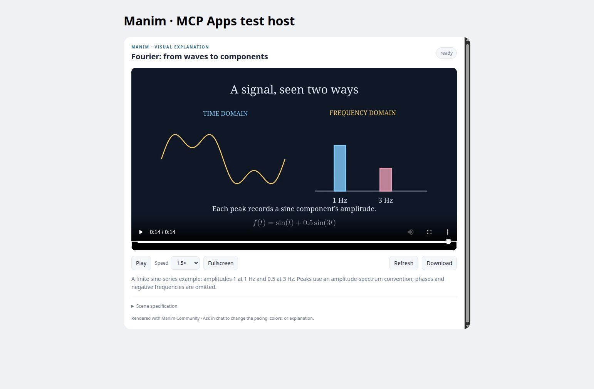

# Manim Animation for ChatGPT

**Turn an explanation into a real animation, then refine it in conversation.**

An open-source MCP plugin that renders [Manim Community](https://www.manim.community/)
scenes and presents an HTML5 player through MCP Apps. The conversational model authors
a bounded scene specification; the service validates, renders, stores, and displays it.
No second LLM API call is needed.

> **Release status:** working, tested developer preview. Real rendering, HTTPS MCP,
> and the embedded player have been verified. ChatGPT installation and model-driven
> invocation have **not** been verified. Stable hosting and OAuth configuration remain
> deployment prerequisites. This project is not affiliated with or endorsed by OpenAI.



*Screenshot of the actual player in the included bridge test host, not a ChatGPT chat.*

## What it does

- Renders text, safe mathematical notation, sampled graphs, shapes and algorithm diagrams.
- Supports movement, rotation, scaling, transformations, highlighting and paced timelines.
- Produces H.264 MP4 at 480p, 720p or 1080p, up to 90 seconds.
- Preserves scene specifications, identifiers, revision parents and editing instructions.
- Reuses identical renders within an authenticated account.
- Provides play/pause, native scrubbing, speed controls, host-permitted fullscreen,
  temporary downloads, source specification, loading states and diagnostics.
- Runs every render in a disposable, resource-limited, network-disabled container.

Try: “Animate a hash collision using separate chaining.” Then: “Make it twice as
slow.” The model must select the installed plugin and translate the request to the
supported scene vocabulary; tool descriptions and the bundled skill guide this
choice but cannot guarantee automatic invocation.

## Examples

| Concept | Specification | Real rendered output |
| --- | --- | --- |
| Fourier decomposition | [JSON](examples/fourier.json) | [MP4](assets/fourier.mp4) |
| Separate chaining | [JSON](examples/hash-chaining.json) | [MP4](assets/hash-chaining.mp4) |
| Rotation and translation | [JSON](examples/geometry.json) | [MP4](assets/geometry.mp4) |

The Fourier example is a finite sine-series amplitude spectrum, not a full
numerical transform demonstration. Its conventions and omissions are stated in
its caption. The model can construct other scenes using sampled polylines and
explicit timelines.

## Run locally

Prerequisites: Linux, Python 3.12+, and **rootless Podman with cgroups v2**.
Docker-compatible worker commands are supported, but the verified isolation path
is rootless Podman. FFmpeg, fonts and TeX live in the worker image.

```sh
git clone https://github.com/OwenPawl/chatgpt-manim.git
cd chatgpt-manim
python3 -m venv .venv
.venv/bin/pip install -r requirements.lock
.venv/bin/pip install -e '.[test]'
podman build -f worker/Dockerfile -t localhost/chatgpt-manim-worker:0.1.0 .
.venv/bin/python scripts/configure_local.py
.venv/bin/python scripts/serve.py
```

The endpoint is `http://127.0.0.1:8787/mcp`. Credentials are generated into `.env`
(mode 0600), never printed or committed. Configure your MCP client's bearer
credential from `MANIM_API_KEY`. The portable `mcp.json` supplies the endpoint;
it intentionally contains no secret. A configured MCP client can discover
`animation_capabilities`, `render_animation`, `get_animation` and `revise_animation`.

```sh
.venv/bin/pytest -q
MANIM_INTEGRATION=1 .venv/bin/pytest -q tests/test_integration.py
.venv/bin/python scripts/render_examples.py
```

For a browser smoke test, set `MANIM_ENABLE_PREVIEW=1` in `.env`, restart, and run
`.venv/bin/python scripts/smoke_remote.py`. It writes a 15-minute scoped test-host
URL to `.agent/preview-url.txt`. Open that URL in a browser. The harness uses the
same player and documented MCP Apps bridge messages; it is not the real ChatGPT host.

## Install in ChatGPT

See [installation](docs/installation.md) for the exact supported flow. Current
OpenAI documentation instructs testing custom plugins in **ChatGPT Work**. Standard
Chat surface availability must be checked independently; native automatic animation
integration is not claimed.

The current custom-server form supports OAuth, no authentication, or mixed OAuth.
It does not accept a fixed bearer key. **Do not select “No authentication” for this
protected service.** Configure a suitable OAuth 2.1 provider, or use a private
Secure MCP Tunnel with the required Platform authorization.

## Deployment and security

Read [deployment](docs/deployment.md), [architecture](docs/architecture.md),
[security](SECURITY.md), and [verification](docs/verification.md).
The service is designed for a single small Linux host: native MCP process plus
rootless worker containers, behind a TLS reverse proxy. A server Dockerfile and
Compose configuration are included for operators who use a rootless Podman socket.
No cloud signup or paid hosting is required for local use.

Model-authored **Python is not accepted**. Safe declarative input is the intentional
first-release boundary. The worker has no credentials, host mounts or network.
This is not a general code runner.

## Project layout

```text
plugin.json / mcp.json       Portable Agent Plugins package
skills/manim-animation/     Advisory tool-selection and revision guidance
src/chatgpt_manim/           MCP server, auth, persistence, schema and worker launcher
worker/                     Trusted Manim translator and container image
ui/player.html              Standalone MCP Apps player
examples/ / assets/         Scene specs, real MP4s and verified screenshot
scripts/ / tests/           Setup, rendering, smoke checks and automated tests
```

MIT licensed. Contributions are welcome; see [CONTRIBUTING.md](CONTRIBUTING.md).
