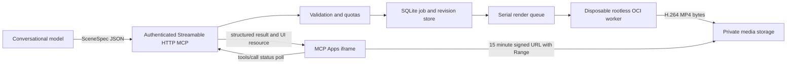

# Architecture

The server uses the official MCP Python SDK 2.3.0. Streamable HTTP requests use
JSON responses and stateless protocol handling; render jobs are durable application
state in SQLite. Jobs transition queued → rendering → ready/failed. A restart
marks interrupted jobs failed, with a retry diagnostic. One worker runs at a time;
up to eight pending jobs, thirty new jobs per owner per day, and one hundred retained
jobs are allowed. Seven-day cleanup runs on submission. Identical scene hashes,
including a renderer-version salt, reuse ready or pending jobs within the owner.

`get_animation` returns the complete specification for conversational continuity.
`revise_animation` creates a new job with its parent and recorded intent; the model
must supply a revised spec or an absolute pacing multiplier. The server never
interprets natural language or calls another LLM. An unchanged revision can resolve
to a cached job, so it does not create a redundant revision record.

The trusted renderer translates validated operations to Manim objects and animations.
There is no source evaluation. Mathematical notation is allowlisted before TeX sees
it. The worker reads bounded JSON through stdin and writes one bounded MP4 through
stdout; diagnostics use stderr. There are no host bind mounts, container sockets,
credentials or outbound network inside workers. The controller must hold local
container-launch authority; keep it on a dedicated unprivileged OS account.

The UI implements the MCP Apps JSON-RPC bridge: `ui/initialize`, initialized/tool-result
notifications and `tools/call`. The resource MIME is `text/html;profile=mcp-app` and
its URI is linked through `_meta.ui.resourceUri` (plus the ChatGPT compatibility
alias). The resource advertises its media origin through `_meta.ui.csp`. Media
URLs live in result `_meta`; model-visible structured data contains the spec and ID.
The browser renders values via textContent, never as user-authored HTML.

OAuth is resource-server verification, not a homegrown authorization server.
An established IdP must handle user login, consent, PKCE and client registration.
The service verifies signatures, issuer, audience, timestamps and scope. Ownership
is derived from issuer+subject, never a client-selected field. Fixed bearer mode
has one personal owner and is intended for development clients.

## Current scaling boundary

Run one server process and one replica. SQLite, the task set, semaphore and rate
limits are local. Do not enable multiple Uvicorn workers or replicas: initialization
would mark another instance's active jobs failed and per-process quotas would diverge.
For larger deployments, replace the in-process queue with a durable broker, use
shared storage, add distributed rate limiting, and implement retries/leases and
object-store lifecycle retention. Container version tags are pinned; production
operators should additionally pin reviewed image digests and scan dependencies.
